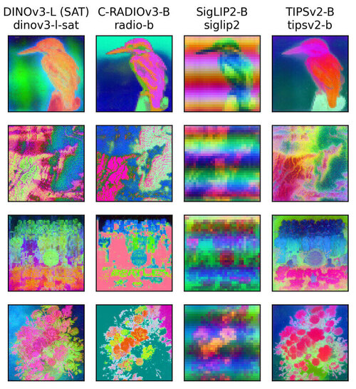

:::{#hero-heading}
**I am a researcher and PhD candidate at the Finnish Environment Institute (Syke), working on deep learning and computer vision for environmental monitoring.**

My work focuses on topics like fine-grained classification, out-of-distribution detection and multimodal learning from images, videos and DNA data, with applications in biodiversity monitoring and remote sensing.

I hold a MSc in Electrical Engineering from Tampere University, with a major in Signal Processing. During my studies I interned at **Intel**, where I worked with 3A algorithms, and at **Vaisala**, focusing on deep learning methods for predictive maintenance.

I am a member in several expert groups, including:

- **EIONET Data and Digitalization** (European Environment Agency).
- **Lukki**, Finland's national coordination group for nature information.
- **GEO AI4EO**, a GEO subgroup focused on geospatial AI for Earth Observation.

:::

## [Selected publications](publications.qmd)

Google scholar: [[Link]]( https://scholar.google.com/citations?user=fBDisEYAAAAJ&hl=fi)

::: {.pub}
{.pub-img}

::: {.pub-text}
**Computer vision-based estimation of small arthropod biomass**\
[**Mikko Impiö**, Philipp M. Rehsen, Jarrett Blair, Cecilie Mielec, Arne J. Beermann, Florian Leese, Toke T. Høye, Jenni Raitoharju]{.pub-authors}\
[Ecological Informatics, 2026]{.pub-venue}\
[\[paper\]](https://doi.org/10.1016/j.ecoinf.2026.104091) [\[code\]](https://github.com/mikkoim/invertebrate-biomass) [\[dataset\]](https://doi.org/10.5281/zenodo.20019571)
:::
:::

::: {.pub}
{.pub-img}

::: {.pub-text}
**AquaMonitor: A multimodal multi-view image sequence dataset for real-life aquatic invertebrate biodiversity monitoring**\
[**Mikko Impiö**, Philipp M. Rehsen, Tiina Laamanen, Arne J. Beermann, Florian Leese, Jenni Raitoharju]{.pub-authors}\
[arXiv preprint arXiv:2505.22065, 2025]{.pub-venue}\
[\[paper\]](https://arxiv.org/abs/2505.22065) [\[code\]](https://github.com/mikkoim/aquamonitor) [\[dataset\]](https://huggingface.co/datasets/mikkoim/aquamonitor)
:::
:::

::: {.pub}
{.pub-img}

::: {.pub-text}
**Improving taxonomic image-based out-of-distribution detection with DNA barcodes**\
[**Mikko Impiö**, Jenni Raitoharju]{.pub-authors}\
[2024 32nd European Signal Processing Conference (EUSIPCO), 2024]{.pub-venue}\
[\[paper\]](https://arxiv.org/pdf/2406.18999)
:::
:::

::: {.pub}
{.pub-img}

::: {.pub-text}
**Remote sensing the habitats of Northern Lapland – Final project report, parts 1 and 2**\
[*Ylä-Lapin luonnon kaukokartoitus – Projektin loppuraportti, osat 1 ja 2*]{.pub-authors}\
[Anna Tammilehto, Pekka Härmä, Minna Kallio, Markus Törmä, Arto Saikkonen, Seppo Tuominen, **Mikko Impiö**, Mika Heikkinen, Mikko Kervinen, Tytti Jussila, Kristin Böttcher, Elisa Pääkkö, Aira Kokko, Katariina Mäkelä, Saku Anttila]{.pub-authors}\
[Metsähallituksen luonnonsuojelujulkaisuja, Sarja A 248 & 249, 2024]{.pub-venue}\
[\[report 1\]](https://julkaisut.metsa.fi/wp-content/uploads/sites/2/2024/02/a248.pdf) [\[report 2\]](https://julkaisut.metsa.fi/wp-content/uploads/sites/2/2024/02/a249.pdf)
:::
:::

::: {.pub}
{.pub-img}

::: {.pub-text}
**The Riverine Organism Drift Imager: A new technology to study organism drift in rivers and streams**\
[Frédéric de Schaetzen, **Mikko Impiö**, Basil Wagner, Patryk Nienaltowski, Michael Arnold, Martin Huber, Matthias Meyer, Jenni Raitoharju, Luiz G. M. Silva, Roman Stocker]{.pub-authors}\
[Methods in Ecology and Evolution, 2023]{.pub-venue}\
[\[paper\]](https://besjournals.onlinelibrary.wiley.com/doi/full/10.1111/2041-210X.14130)
:::
:::

::: {.pub}
{.pub-img}

::: {.pub-text}
**Multi-level reversible encryption for ECG signals using compressive sensing**\
[**Mikko Impiö**, Mehmet Yamaç, Jenni Raitoharju]{.pub-authors}\
[ICASSP 2021 – IEEE International Conference on Acoustics, Speech and Signal Processing, 2021]{.pub-venue}\
[\[paper\]](https://arxiv.org/abs/2104.05325) [\[code\]](https://github.com/mikkoim/ECG-CS)
:::
:::

## [Code](https://github.com/mikkoim)

Github: [[Link]](https://github.com/mikkoim)

::: {.pub}
{.pub-img}

::: {.pub-text}
**`dinotool`**\
[Command-line tool for extracting DINO, CLIP, SigLIP2, TIPSv2, RADIO, features for images and videos]{.pub-venue}\
[\[code\]](https://github.com/mikkoim/dinotool) [★]{.gh-stars data-repo="mikkoim/dinotool"}
:::
:::

::: {.pub}
::: {.pub-text}
**`taxonomist`**\
[A library for training deep learning models for species classification.]{.pub-venue}\
[\[code\]](https://github.com/mikkoim/taxonomist) [★]{.gh-stars data-repo="mikkoim/taxonomist"}
:::
:::

::: {.pub}
::: {.pub-text}
**`tiers`**\
[A hierarchical label handling library for Python]{.pub-venue}\
[\[code\]](https://github.com/mikkoim/tiers) [★]{.gh-stars data-repo="mikkoim/tiers"}
:::
:::

::: {.pub}
::: {.pub-text}
**`point-eo`**\
[A python libary that makes it simple to sample points from large rasters, fit ML models and perform inference on larger-than-memory rasters.]{.pub-venue}\
[\[code\]](https://github.com/sykefi/point-eo) [★]{.gh-stars data-repo="sykefi/point-eo"}
:::
:::
