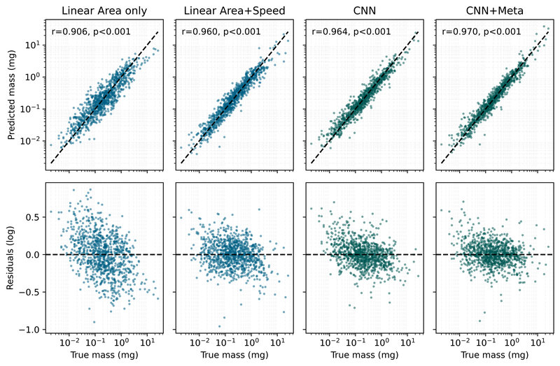
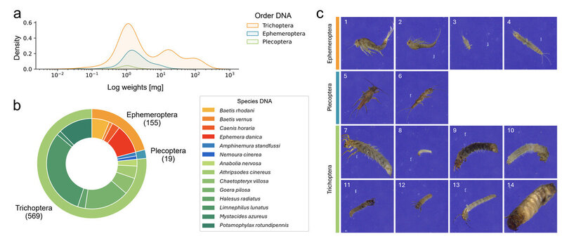
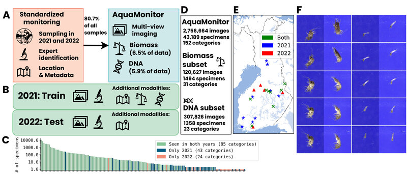
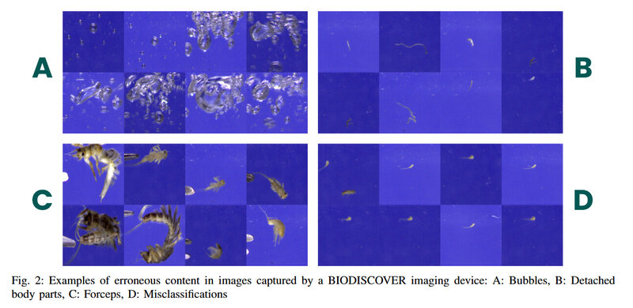
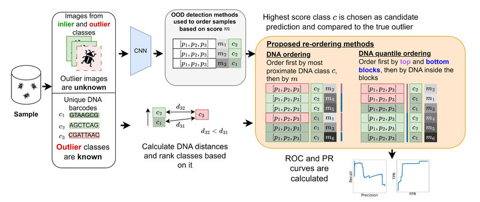
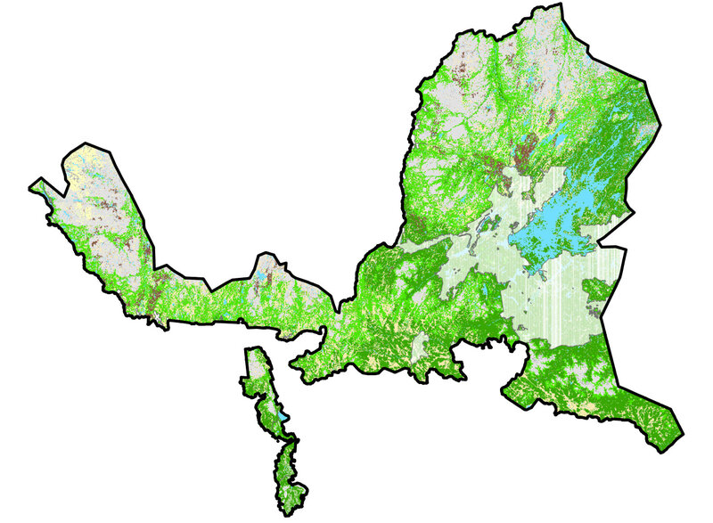
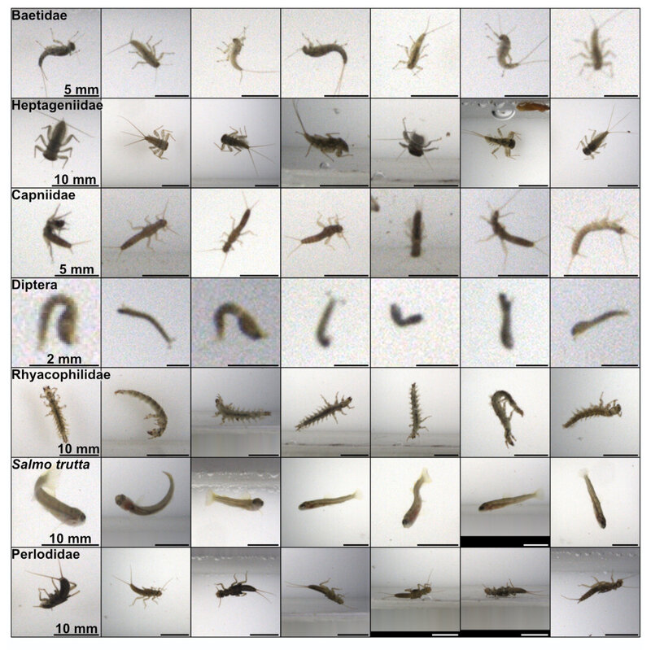
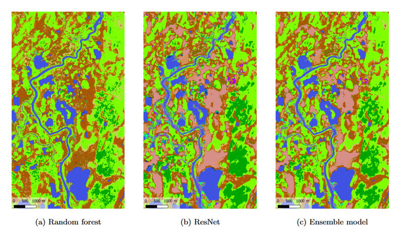
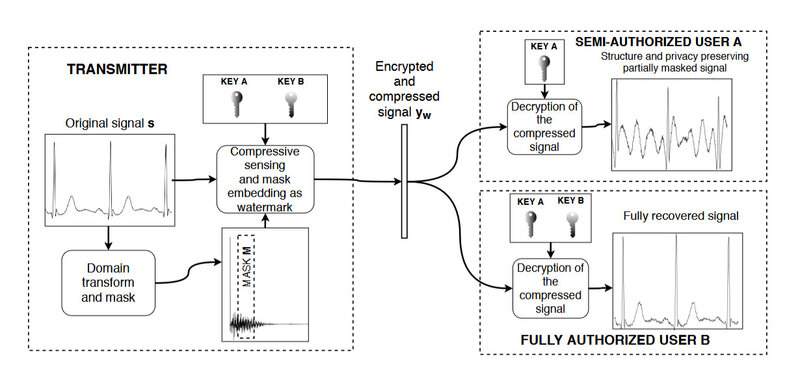

::: {.pub}
{.pub-img}

::: {.pub-text}
**Computer vision-based estimation of invertebrate biomass**\
[**Mikko Impiö**, Philipp M. Rehsen, Jarrett Blair, Cecilie Mielec, Arne J. Beermann, Florian Leese, Toke T. Høye, Jenni Raitoharju]{.pub-authors}\
[arXiv preprint arXiv:2603.06362, 2026]{.pub-venue}\
[\[paper\]](https://arxiv.org/abs/2603.06362) [\[dataset\]](https://zenodo.org/records/19454159)
:::
:::

::: {.pub}
{.pub-img}

::: {.pub-text}
**Improving taxonomic resolution, biomass and abundance assessments of aquatic invertebrates by combining imaging and DNA megabarcoding**\
[Philipp M. Rehsen, Mia S. Honka, **Mikko Impiö**, Iris Madge Pimentel, Florian Leese, Arne J. Beermann]{.pub-authors}\
[PeerJ 14, e20501, 2026]{.pub-venue}\
[\[paper\]](https://peerj.com/articles/20501) [\[dataset\]](https://zenodo.org/records/15966820)
:::
:::

::: {.pub}
{.pub-img}

::: {.pub-text}
**AquaMonitor: A multimodal multi-view image sequence dataset for real-life aquatic invertebrate biodiversity monitoring**\
[**Mikko Impiö**, Philipp M. Rehsen, Tiina Laamanen, Arne J. Beermann, Florian Leese, Jenni Raitoharju]{.pub-authors}\
[arXiv preprint arXiv:2505.22065, 2025]{.pub-venue}\
[\[paper\]](https://arxiv.org/abs/2505.22065) [\[code\]](https://github.com/mikkoim/aquamonitor) [\[dataset\]](https://huggingface.co/datasets/mikkoim/aquamonitor)
:::
:::

::: {.pub}
{.pub-img}

::: {.pub-text}
**Efficient curation of invertebrate image datasets using feature embeddings and automatic size comparison**\
[**Mikko Impiö**, Jenni Raitoharju]{.pub-authors}\
[2025 IEEE Symposia on Computational Intelligence for Energy, Transport and Environmental Sustainability (CIETES), 2025]{.pub-venue}\
[\[paper\]](https://arxiv.org/pdf/2412.15844?) [\[code\]](https://github.com/mikkoim/taxonomist-studio)
:::
:::

::: {.pub}
{.pub-img}

::: {.pub-text}
**Improving taxonomic image-based out-of-distribution detection with DNA barcodes**\
[**Mikko Impiö**, Jenni Raitoharju]{.pub-authors}\
[2024 32nd European Signal Processing Conference (EUSIPCO), 2024]{.pub-venue}\
[\[paper\]](https://arxiv.org/pdf/2406.18999)
:::
:::

::: {.pub}
{.pub-img}

::: {.pub-text}
**Remote sensing the habitats of Northern Lapland – Final project report, parts 1 and 2**\
[*Ylä-Lapin luonnon kaukokartoitus – Projektin loppuraportti, osat 1 ja 2*]{.pub-authors}\
[Anna Tammilehto, Pekka Härmä, Minna Kallio, Markus Törmä, Arto Saikkonen, Seppo Tuominen, **Mikko Impiö**, Mika Heikkinen, Mikko Kervinen, Tytti Jussila, Kristin Böttcher, Elisa Pääkkö, Aira Kokko, Katariina Mäkelä, Saku Anttila]{.pub-authors}\
[Metsähallituksen luonnonsuojelujulkaisuja, Sarja A 248 & 249, 2024]{.pub-venue}\
[\[report 1\]](https://julkaisut.metsa.fi/wp-content/uploads/sites/2/2024/02/a248.pdf) [\[report 2\]](https://julkaisut.metsa.fi/wp-content/uploads/sites/2/2024/02/a249.pdf)
:::
:::

::: {.pub}
{.pub-img}

::: {.pub-text}
**The Riverine Organism Drift Imager: A new technology to study organism drift in rivers and streams**\
[Frédéric de Schaetzen, **Mikko Impiö**, Basil Wagner, Patryk Nienaltowski, Michael Arnold, Martin Huber, Matthias Meyer, Jenni Raitoharju, Luiz G. M. Silva, Roman Stocker]{.pub-authors}\
[Methods in Ecology and Evolution, 2023]{.pub-venue}\
[\[paper\]](https://besjournals.onlinelibrary.wiley.com/doi/full/10.1111/2041-210X.14130)
:::
:::

::: {.pub}
{.pub-img}

::: {.pub-text}
**Habitat classification from satellite observations with sparse annotations**\
[**Mikko Impiö**, Pekka Härmä, Anna Tammilehto, Saku Anttila, Jenni Raitoharju]{.pub-authors}\
[arXiv preprint arXiv:2209.12995, 2022]{.pub-venue}\
[\[paper\]](https://arxiv.org/abs/2209.12995)
:::
:::

::: {.pub}
{.pub-img}

::: {.pub-text}
**Multi-level reversible encryption for ECG signals using compressive sensing**\
[**Mikko Impiö**, Mehmet Yamaç, Jenni Raitoharju]{.pub-authors}\
[ICASSP 2021 – IEEE International Conference on Acoustics, Speech and Signal Processing, 2021]{.pub-venue}\
[\[paper\]](https://arxiv.org/abs/2104.05325) [\[code\]](https://github.com/mikkoim/ECG-CS)
:::
:::
